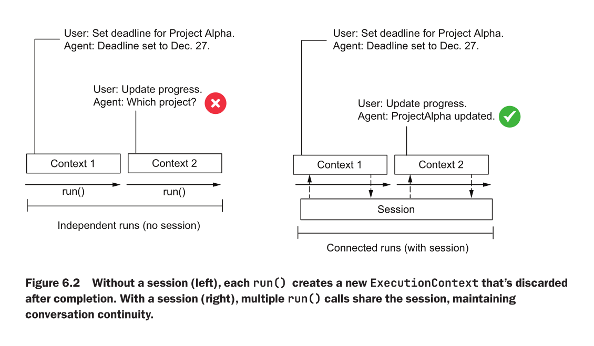
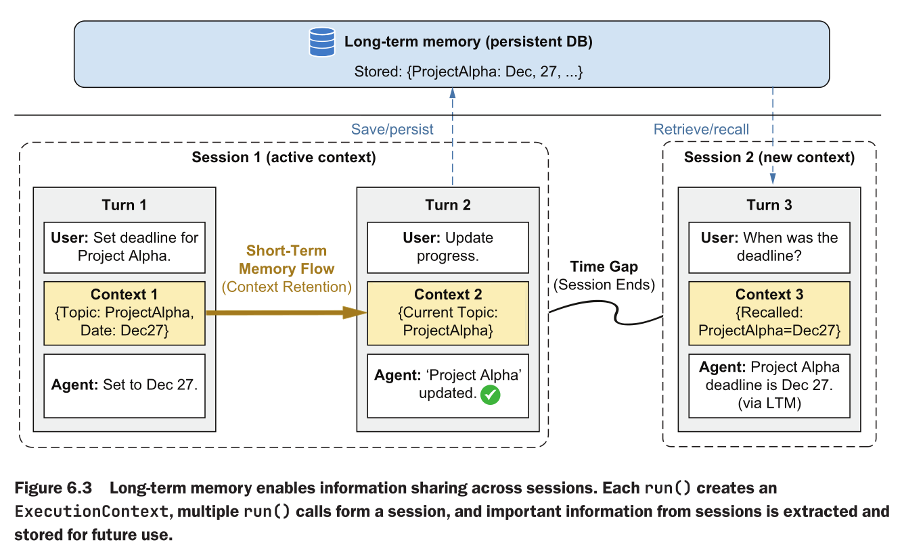
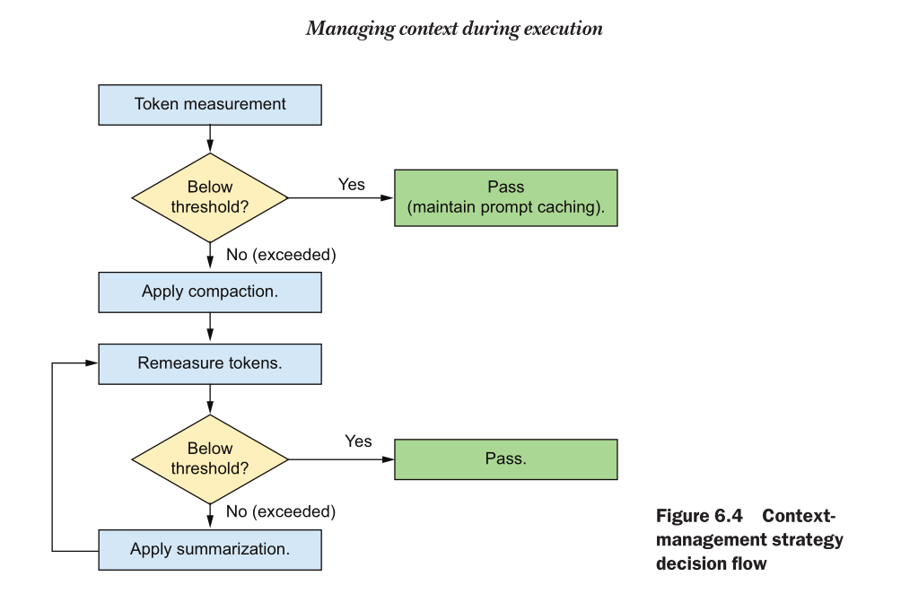

## Chapter 6: Adding Memory 

### This Chapter Covers

- Understanding the role of memory in LLM agents
- Managing context growth with sliding window, compaction, and summarization
- Implementing sessions for multiturn conversations
- Building asynchronous human-in-the-loop workflows
- Creating long-term memory for cross-session knowledge retention

Memory is what separates a stateless tool from an intelligent assistan

This chapter addresses memory in three use patterns:

- **context optimization strategies**
- **Session**and **SessionManager** classes
- **long-term memory system**

### The Anatomy of Agent Memory

- Limitations of our current agent
- Distinguish between short-term and long-term memory
- Further divide short-term memory into two patterns based on agent use.

#### Limitations of the current memory architecture

- A problem of space
- A problem of time

#### Three challenges of the current memory architecture

First three concepts that form the foundation of Agent memory

- A **session** is a single, continuous conversation between a user and an agent.
- **Short-term memory** stores the work done within a single session
- **Long-term memory** is information that persists after sessions end

  
CHALLENGE 1: CONTEXT EXPLOSION
- How to compress context during current execution.

  
CHALLENGE 2: LACK OF CONVERSATION CONTINUITY
- Need to implenet a **Session** to maintain continuity between calls to run()

CHALLENGE 3: LACK OF PERSISTENT KNOWLEDGE

  
#### Context Engineering and Memory

Chapter 1 defined context engineering as the art of providing the right
information at the right time and introduced five strategies (see below).
This chapter is a hub in which three of these strategies converge

	STRATEGY        DESCRIPTION
	Generation      Constructing context with LLM-generated outputs
	Retrieval       Bringing information from external sources into context
	Write           Saving from context to external storage
	Reduce          Compressing and deleting context
	Isolate         Separating tasks/tools into distinct environments
	

Each challenge defines a use pattern that this chapter addresses:

- Pattern 1, **in-run** context management (challenge 1):
  Keeps context under control as it grows during a single run() call
  
- Pattern 2, **continuous execution** (challenge 2):
  Maintains context across multiple run() calls within the same session
  
- Pattern 3, **long-term memory** (challenge 3):
  Preserves and retrieves information after a session ends
  
  
### Managing Context During Execution

#### Separating storage from presentation

The first principle of context management is separating storage from presentation. All events recorded in ExecutionContext.events remain immutable; only the
LlmRequest.contents sent to the LLM are processed.

WHY THIS SEPARATION MATTERS

**ExecutionContext** is your ground truth: a complete, structured record of
everything that happened.

**LlmRequest** is simply a computed projection that you can refine and optimize
for each specific model call.

IMPLEMENTATION VIA CALLBACKS

Chapter 4 introduced **before_llm_callback**. This callback executes 
just before the LLM call, providing an opportunity to process the LlmRequest.

The callback receives both **ExecutionContext** and **LlmRequest**. It
reads the current state from ExecutionContext and modifies the contents
of LlmRequest

	before_llm_callback(context: ExecutionContext, request: LlmRequest)
	-> Optional[LlmResponse]

To apply context-optimization strategies flexibly, you adjust configuration
values such as token thresholds.

	def create_optimizer_callback(apply_optimization, threshold: int = 50000):
		"""Factory function that creates a callback applying optimization
		strategy"""
		async def callback(
			context: ExecutionContext,
			request: LlmRequest
			) -> Optional[LlmResponse]:
			token_count = count_tokens(request)
		
			if token_count < threshold:
				return None
			
			# Support both sync and async functions
			result = apply_optimization(context, request)
				if inspect.isawaitable(result):
				await result
			return None
		return callback
			
#### Sliding-Window Strategy 

BASIC IMPLEMENTATION

The following function implements a sliding-window strategy with three steps:

1. Iterate through the contents to find the user’s original question.
2. Unconditionally preserve everything up to the user’s message, so that the
   agent retains the problem context.
3. Keep only the most recent window_size items from subsequent items
   (assistant messages, tool calls, tool results).

LIMITATIONS

Therefore, more precise management requires measuring token counts directly.

#### Token Counting

The LLM’s actual limit is determined by token count, not message count. A single file
read result might take up 10,000 tokens, whereas 20 short conversations combined
might take up only 500 tokens. Accurate context management requires measuring
token counts directly.

INTRODUCING TIKTOKEN

- **tiktoken** is a tokenizer library provided by OpenAI

- Use **build_messages** function  to build messages from **LLMRequest object**

- **count_tokens** function counts
  - Per-message overhead (role, separators, etc.)
  - Content tokens
  - Tool_call tokens
  - Tool definition tokens

WHY OPTIMIZATION MATTERS EVEN BELOW THE LIMIT

Even within the limit, a bloated context creates three problems:
  
1. Cost and latency grow with token count. 
   Model pricing is per-token, and time to first token increases with context size.
2. Irrelevant information distracts the model from the immediate task. 
   ­a phenomenon known as “lost in the middle.”
3. You have to reserve space for the model’s response. 

#### Compaction Strategy

TOOLCALL COMPRESSION: WRITE OPERATIONS

TOOLRESULT COMPRESSION: READ OPERATIONS

IMPLEMENTATION

TRADEOFFS WITH PROMPT CACHING

#### Summarization Strategy

SELECTING SUMMARIZATION TARGETS

DESIGNING THE SUMMARY PROMPT

IMPLEMENTATION

COMPACTION VS. SUMMARIZATION

#### Hierarchical Context Management

### Long-term memory: Accumulating knowledge across sessions

#### The structure of long-term memory

The SessionManager we implemented earlier and the MemoryManager introduced here
address different problems:

**SessionManager** maintains conversation continuity within a session. 
When you call run() multiple times with the same session_id, the previous
conversation content is preserved. But starting a new conversation with
a different session_id prevents access to the previous session content.

**MemoryManager** stores important information even after a session
ends, allowing retrieval and use in future sessions. Examples include “the user
mentioned that they’re a marketer” or “the approach used when solving this
problem before.
  

Long-term memory systems have two core operations:

**Storage (Write)**
**Retrieval (Read)**

Recent memory libraries such as **Mem0** and **Graphiti** improve on this by
using LLMs to extract only information worth preserving. When storing new
information, these libraries perform one of four operations to manage
conflicts with existing memories:

1. **ADD** stores new information that doesn’t already exist.
2. **UPDATE** modifies existing memories.
3. **DELETE** removes contradictory memories.
4. **SKIP** ignores information that’s already stored.

#### Information extraction: Structured output

EXTENDING LLMCLIENT

DEFINING THE MEMORY SCHEMA

EXTRACTION PROMPT DESIGN

#### Building a vector store with ChromaDB 

BASIC USE
USING METADATA

#### Implementing TaskMemoryManager 

MEMORY EXTRACTION METHODS
DUPLICATE CHECK METHOD
SAVE METHOD
SEARCH METHOD
INTEGRATING MEMORYMANAGER INTO THE AGENT

#### Retrieving Memories

AUTOMATIC INJECTION WITH PROCESS_LLM_REQUEST
INTEGRATING INTO THE AGENT

### Summary

- Memory transforms an agent from a stateless tool to an intelligent
  assistant that learns and adapts across interactions.

- The three use patterns address different challenges.
  Pattern 1 (one-off execution) manages context within a single run,
  Pattern 2 (continuous execution) maintains conversation across multiple runs
  Pattern 3 (long-term memory) preserves knowledge across sessions.
  
- Context-management strategies follow a hierarchical approach: measure tokens,
  apply compaction for tool results, and use summarization as a last resort. The
  key principle is separating storage from presentation: ExecutionContext
  remains immutable, whereas LlmRequest is optimized for each call.

- Session and SessionManager enable multiturn conversations by persisting events
  and state across run() calls. The same architecture supports asynchronous HITL
  workflows, in which execution pauses for user approval and resumes when
  confirmation arrives.

- Long-term memory combines write and retrieval strategies. Structured informa-
  tion is extracted from execution history, checked for duplicates, stored
  in a vector database, and retrieved when it’s relevant to new tasks.

- Memory retrieval can be implemented as an explicit tool the agent calls on
  demand or as automatic injection via process_llm_request() that adds relevant
  context before every LLM call.

--- 
