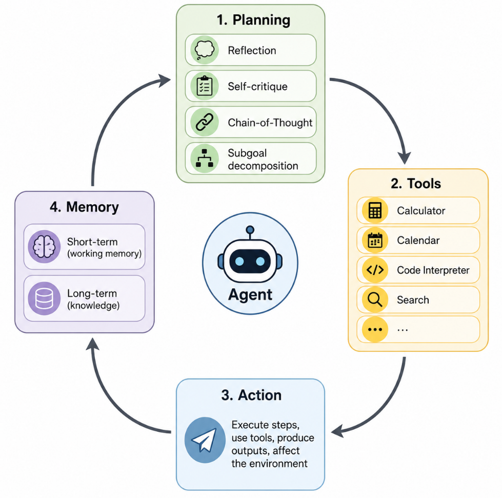
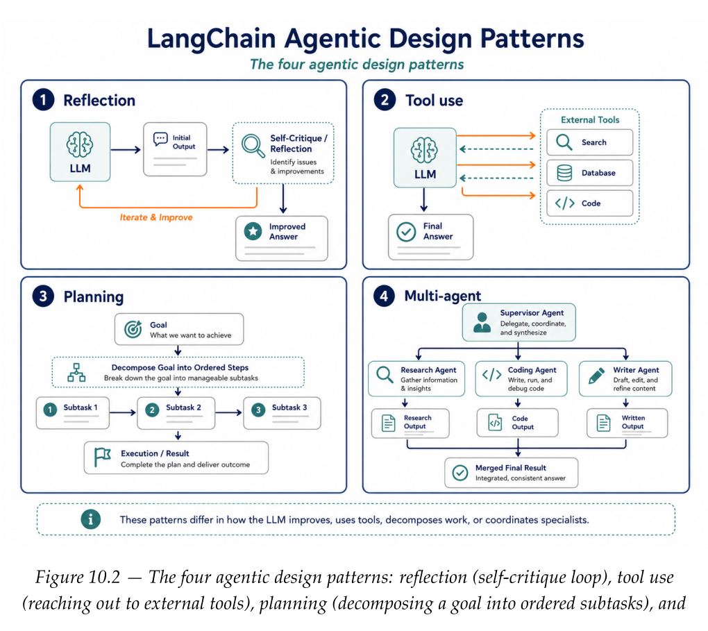
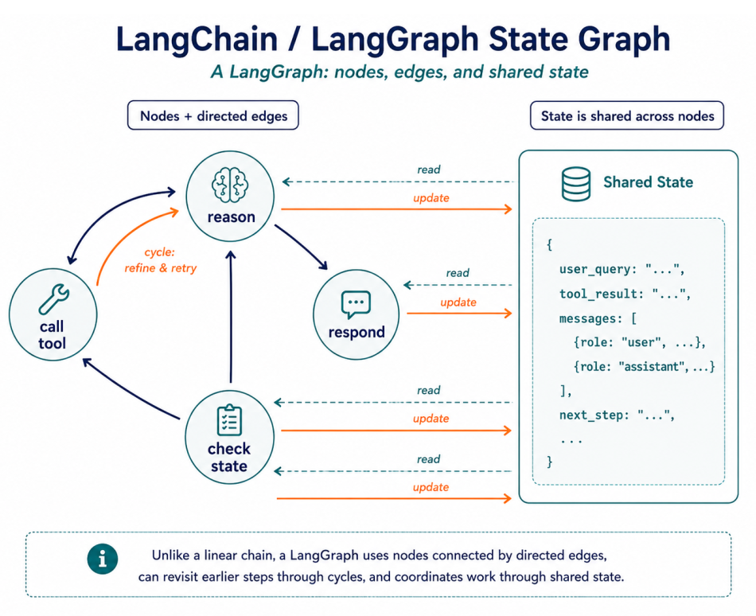
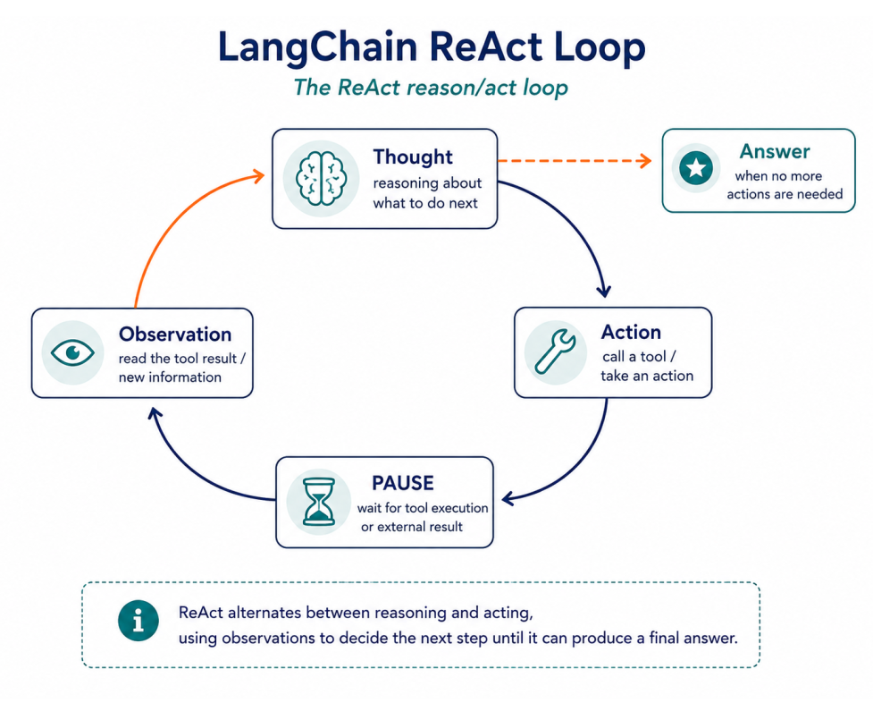

# Chapter 10: Introduction to LLM Agents & LangGraph

## Introduction to Agents

The shift from chains to agents is a shift from fixed pipelines to systems  
that can decide what step to take next.  
    
Agents introduce more moving parts than chains:  

	state
    tool calls
	loops
	branching decisions
	failure handling
	multiple cooperating actors.
	
An **agent** has a goal, observes the current situation, chooses an action,  
sees the result, and decides what to do next.  

	autonomy
	adaptive reasoning
	language understanding
	workflow optimization
	multi-agent & system interaction

LangChain’s founder, **Harrison Chase**, has described every agent as resting  
on four building blocks: **Planning**, **Memory**, **Tools**, and **Action**.   
  
They run in a loop until the task is done. This loop is the basic shape  
behind many agent systems, whether the implementation is a few lines of   
Python or a production LangGraph application.  
  
Once a model can call tools, write data, or make decisions over several steps,  
you need stronger observability and control than you would for a simple  
prompt-response application.  
  
The following four building blocks contiuosly run in a loop until the agent  
is able to accomplish the task:  

	Planning
	Tools
	Action
	Memory
	

  
  
An **agentic workflow** is a sequence of well-defined jobs executed dynamically  
by AI agents and orchestrated as part of a larger end-to-end process  
  
  

  
  
The word “workflow” is important. Useful agents are usually not open-ended chatbots  
that can do anything. They are designed around a job. The clearer the workflow,  
the easier it is to define tools, state, success criteria, and safety boundaries.  
They usually follows three steps:  

	Identify the workflow and its structure
	Specify and create the agents
	Assemble the workflow

---

## Introduction to LangGraph

### Core Concepts

• **Graph structure**: Model your application as a directed graph. Each node  
  does a unit of work (often an LLM call or a tool), and edges route control  
  and data between nodes.  
	  
• **State Management**: LangGraph tracks and persists a shared state across  
  steps. As nodes run, the state is updated,  
    
• **Coordination**: LangGraph ensures nodes run in the right order and that  
  the right information flows between them, so you can focus on the logic  
  rather than the plumbing  
  
  

  
  

### Benefits

• **Simplified development**
• **Flexibility**
• **Scalability**
• **Fault Tolerance**

## SUMMARY

• An LLM agent pursues a goal autonomously — reasoning, using tools, and  
  taking actions — rather than answering a single prompt.  

• Every agent rests on four building blocks that cycle continuously:  
  Planning, Memory, Tools, Action.  

• An agentic workflow orchestrates agents to automate an end-to-end process;  
  you build one by defining the structure, creating the agents, then wiring  
  them together.  

• Four design patterns recur: reflection, tool use, planning (including ReAct),  
  and multi-agent collaboration.  
  
• LangGraph models agent applications as stateful, cyclical graphs of nodes  
  and edges, handling state and coordination for you.  

---
