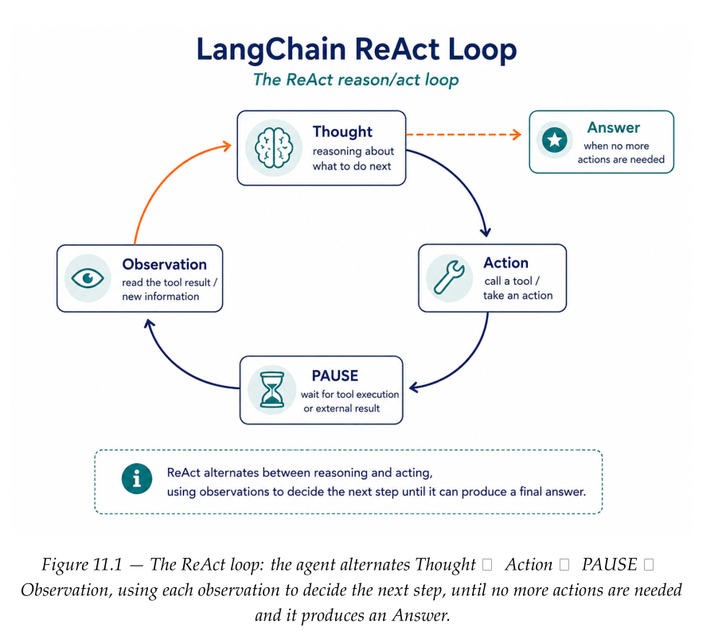
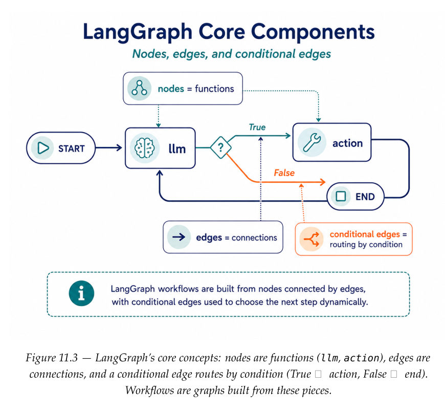
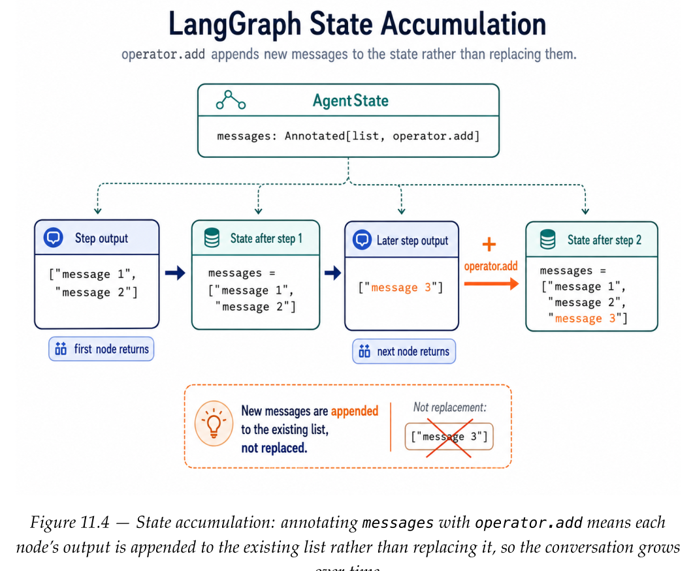
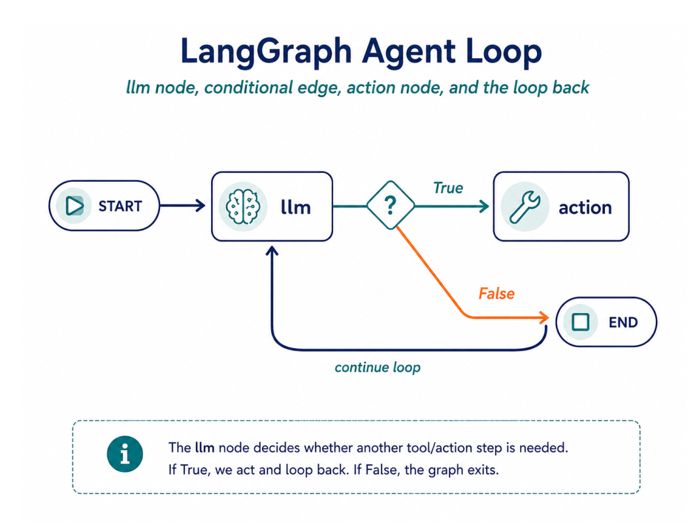

# Chapter 11: Building Agents: from Scratch and with LangGraph

## Part A — A ReAct agent from scratch

The ReAct (Reasoning + Acting) pattern, introduced in the 2022 paper ReAct:  
*Synergizing Reasoning and Acting in Language Models*, has the model alternate   
between **thinking** and **doing**.  
  
It reasons about what it needs, takes an action (calls a tool), observes the  
result, and repeats until it can answer. The important idea is that the model  
does not need to solve everything in one response. It can ask the environment  
for information, incorporate the observation, and continue.  

## Part B: The Same Agent with LangGraph

Two fundamental **LangChain** components form the building blocks of our agent.  
  
1. **Prompt templates** are reusable frameworks that let us create standardized  
   prompts with formatted variables filled dynamically from user content.  
  
2. **Tools** give our agents the ability to interact with external systems and  
   data sources  
  
**LangGraph** operates on three core concepts:  
  
1. **nodes**  
2. **edges**  
3. **conditional edges**  
  
Mapping our agent onto a LangGraph object:  
  
• a node called **llm** that calls the language model,  
• a **conditional edge** that checks for the existence of an action to take,  
• a node called **action** that executes any actions identified.  

 

In this example, the state is just a growing list of messages. Annotating it   
with operator.add tells LangGraph to append new messages rather than replace the  
list. This small annotation is what makes the conversation accumulate across  
graph steps:  

	class AgentState(TypedDict):
		messages: Annotated[list[AnyMessage], operator.add]

### The Agent Implementation

	class Agent:
	
		def __init__(self, model, tools, system=""):
			self.system = system
			graph = StateGraph(AgentState)
			graph.add_node("llm", self.call_model)
			graph.add_node("action", self.take_action)
			graph.add_conditional_edges("llm", self.exists_action, {True: "
			action", False: END})
			graph.add_edge("action", "llm")
			graph.add_edge(START, "llm")
			self.graph = graph.compile()
			self.tools = {t.name: t for t in tools}
			self.model = model.bind_tools(tools)
			
		def exists_action(self, state: AgentState):
			last = state["messages"][-1]
			return len(last.tool_calls) > 0
			
		def call_model(self, state: AgentState):
			messages = state["messages"]
			if self.system:
				messages = [SystemMessage(content=self.system)] + messages
			return {"messages": [self.model.invoke(messages)]}
			
		def take_action(self, state: AgentState):
			tool_calls = state["messages"][-1].tool_calls
			results = []
			for t in tool_calls:
				print(f"Calling: {t['name']} {t['args']}")
				if t["name"] not in self.tools:
					result = "bad tool name, retry"
				else:
			result = self.tools[t["name"]].invoke(t["args"])
			results.append(ToolMessage
				(tool_call_id=t["id"], name=t["name"], content=str(result)))
			print("Back to the model!")
			return {"messages": results}

## Summary

• The **ReAct pattern** alternates Thought � Action � Observation until the  
  agent can answer. You can implement it from scratch with a message list,  
  a system prompt, a dict of tool functions, and a small loop.  
  
• LangGraph expresses that same loop as a graph: an **llm node**, an **action node**, a   
**conditional edge** that decides whether to call a tool, and an edge looping action → llm.  
  
• Binding tools to the model gives native tool calling (no text parsing) and  
supports parallel tool calls.  
  
• The state is a message list annotated with operator.add so each node appends to it.  
  
• For real projects, *create_react_agent* builds this agent for you — but now  
you know exactly what it does under the hood.  

