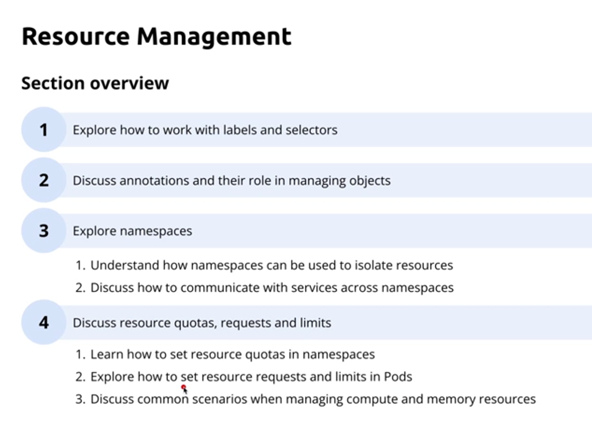
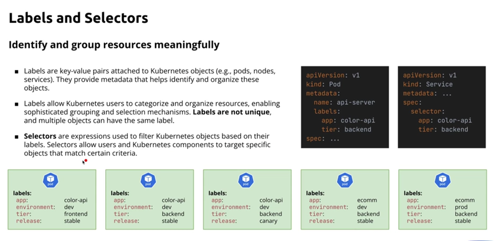

# Advanced Kubernetes: Security and Large-Scale Deployments

## Module 1: Managing Kubernetes Resources

### Introduction to the Course

### Full Specialization Resources

### Introduction to the Section

### Understanding Labels and Selectors

### Lab: Using Labels and Selectors in Kubectl

	kubectl get pods -L app -L tier
	
	NAME             READY   STATUS    RESTARTS   AGE   APP         TIER
	color-backend    1/1     Running   0          91s   color-api   backend
	color-frontend   1/1     Running   0          91s   color-api   frontend

	kubectl get pod -l tier=frontend -L tier
	
	NAME             READY   STATUS    RESTARTS   AGE     TIER
	color-frontend   1/1     Running   0          4m21s   frontend
	
	kubectl get pod -l 'tier notin (frontend)' -L tier
	
	NAME            READY   STATUS    RESTARTS   AGE     TIER
	color-backend   1/1     Running   0          7m21s   backend
	
	kubectl get pod -l 'tier in (frontend, backend)' -L tier
	
	NAME             READY   STATUS    RESTARTS   AGE     TIER
	color-backend    1/1     Running   0          8m43s   backend
	color-frontend   1/1     Running   0          8m43s   frontend

### Lab: Selecting Objects with MatchLabels and MatchExpressions

	apiVersion: apps/v1
	kind: Deployment
	metadata:
		name: color-api
	spec:
		replicas: 3
		selector:
			matchLabels:
				app: color-api
				environment: local
				tier: backend
			matchExpressions: 
				- key: managed
				  operator: Exists
	    template:
			metadata:
				labels:
					app: color-api
					environment: local
					tier: backend
					managed: deployment
			spec:
				containers:
					- name: color-api
					  image: delaray/color-api:1.1.0

### Understanding Annotations

Used by external systems or Kubernetes itself to manage metadata or configure services and tools.  

[Annotations]()  
  

### Introduction to Kubernetes Namespaces

Improve the isolation of groups of resources.  

Four default namesapces created automatically upon cluster creation

	default
	kube-public
	kube-system
	kube-node-lease
  
---
  
### Lab: Creating and Managing Namespaces

	apiVersion: v1
	kind: Namespace
	metadata:
		name: dev

---

If no namespace specified kubewrnetes uses *default* namespace.  

	kubectl get pod --namespace kube-system
	
	NAME                               READY   STATUS    RESTARTS      AGE
	coredns-7d764666f9-8q5rr           1/1     Running   0             13d
	coredns-7d764666f9-nwcfv           1/1     Running   0             13d
	etcd-minikube                      1/1     Running   0             13d
	kube-apiserver-minikube            1/1     Running   0             13d
	kube-controller-manager-minikube   1/1     Running   0             13d
	kube-proxy-6lrkq                   1/1     Running   0             13d
	kube-scheduler-minikube            1/1     Running   0             13d
	storage-provisioner                1/1     Running   2 (13d ago)   13d

---

Setting the current namespace  

	kubectl config current-context
	--> minikube
	
	kubectl config set-context --current --namespace=dev 
	--> Context "minikube" modified.
	
	kubectl config view
	
If you delete a namespace, all resources in the namespaces are deleted.
	
### Lab: Cross-Namespace Service Communication

### Introduction to Resource Quotas, Requests, and Limits

### Lab: Setting Up Resource Quotas

### Setting Resource Requests and Limits

### Managing Rollouts, Resource Requests and Limits

### Startup, Liveliness and Readiness Probes

